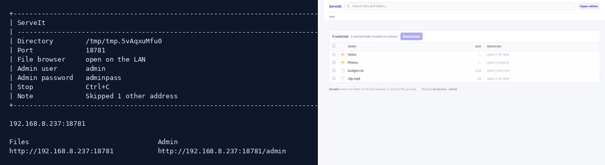
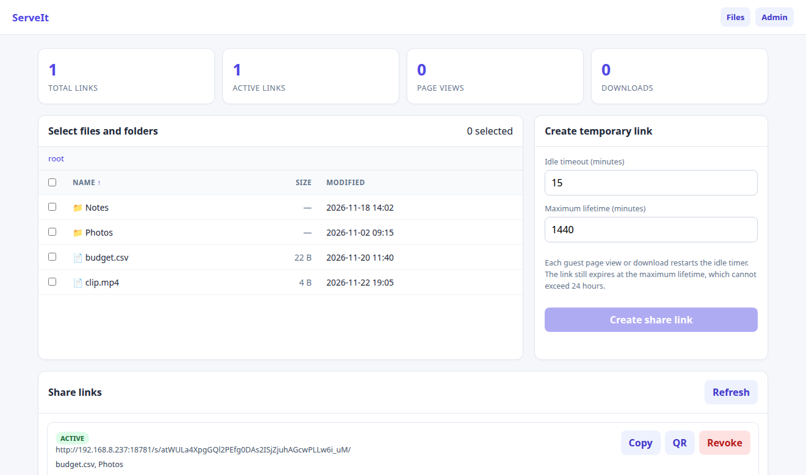
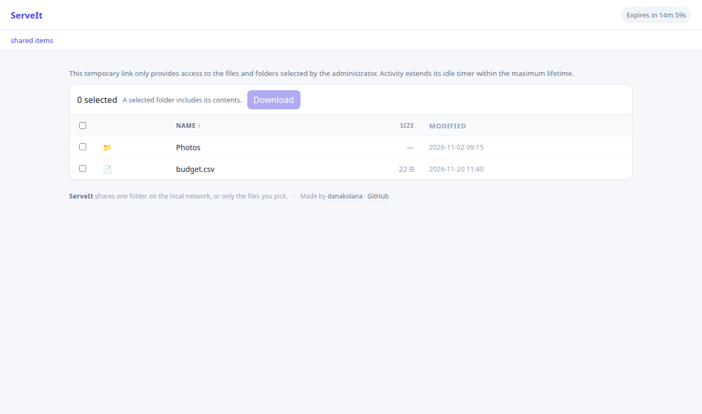

# ServeIt

```bash
wget -O ServeIt https://github.com/Danakolana/ServeIt/releases/latest/download/ServeIt-linux-amd64
chmod +x ServeIt
./ServeIt
```

That downloads the latest Linux build for a 64-bit PC and starts it in the current directory. No runtime, no package install.

The same release publishes the other binaries:

```bash
# Linux, 64-bit ARM
wget -O ServeIt https://github.com/Danakolana/ServeIt/releases/latest/download/ServeIt-linux-arm64

# macOS, Apple silicon
wget -O ServeIt https://github.com/Danakolana/ServeIt/releases/latest/download/ServeIt-macos-arm64

# macOS, Intel
wget -O ServeIt https://github.com/Danakolana/ServeIt/releases/latest/download/ServeIt-macos-amd64

# Windows, 64-bit
wget -O ServeIt.exe https://github.com/Danakolana/ServeIt/releases/latest/download/ServeIt-windows-amd64.exe
```

On macOS, `chmod +x ServeIt` and then `./ServeIt`. On Windows, run `ServeIt.exe` from the folder you downloaded. `releases/latest` always points at the newest published tag.

## Releases

Publishing a tag is what creates the GitHub release. Pushing a tag named like `v1.2.3` runs [`.github/workflows/release.yml`](.github/workflows/release.yml), which cross-compiles five static binaries and attaches them to that release, plus `SHA256SUMS`. You can also start the same workflow manually from the Actions tab and type the tag name there.

| File | System |
|---|---|
| `ServeIt-linux-amd64` | Linux, 64-bit PC |
| `ServeIt-linux-arm64` | Linux, 64-bit ARM |
| `ServeIt-macos-amd64` | macOS, Intel |
| `ServeIt-macos-arm64` | macOS, Apple silicon |
| `ServeIt-windows-amd64.exe` | Windows, 64-bit |

```bash
git tag v1.0.0
git push origin v1.0.0
```

The workflow needs no extra secrets. `contents: write` on the tag workflow is enough to publish the release.

## What it is

The folder on this machine is already a link. Open it from a phone, a laptop on the same network, or hand a guest only the files you picked.







ServeIt is a LAN file server. Point it at any directory, hand someone a link or a QR code, and keep the rest of the disk private.

Most one-command file servers publish the whole tree and stop there. You install a language runtime, pull a package, and everyone who can open the port can walk every subdirectory.

ServeIt is the opposite shape:

- **One file.** The UI, search, auth, and QR codes are compiled in. A release binary is one static file, about **13 MB**. There is no Node, Python, or package directory beside it.
- **Any path, not only the shell’s current directory.** `--dir` is the served root. Everything else is a flag.
- **A real guest boundary.** The admin panel lets you check individual files and folders, including a slice of a subdirectory. Unchecked siblings never appear on the guest link.
- **Links that expire.** Idle timeout plus a hard maximum of 24 hours. Page views and downloads are counted. You can revoke a link immediately.

## Run it

```bash
./ServeIt --dir /data/drop --port 9000
./ServeIt --dir ~/Videos --port 8080 --password guest --admin-password owner
```

On Windows the program name is `ServeIt.exe`. The flags are the same.

On startup, after the port is open, one panel lists the directory, port, file-browser auth, admin user, admin password, and how to stop (`Ctrl+C`). QR codes are printed for `192.168.x.x` addresses only. If another address was skipped, the panel says so in one line. With no `192.168` address, the panel falls back to `127.0.0.1`. The password is only in that panel.

| Flag | Default | What it does |
|---|---|---|
| `--dir` | `.` | Directory to publish. Absolute or relative. This is the only root guests and the file browser can see. |
| `--port` | `8080` | TCP port. The process listens on all interfaces. |
| `--password` | empty | Basic-auth password for the main browser and search. Username is always `admin`. Empty means the file browser is open on the LAN. |
| `--admin-password` | generated | Password for `/admin`. Username is `admin`. If omitted, ServeIt reuses `--password`. If both are empty, it prints a random admin password. |

```bash
./ServeIt
./ServeIt --dir /home/user/files --port 9000
./ServeIt --dir /data --port 8888 --password hunter2 --admin-password separate-secret
```

## What you get

**File browser.** Breadcrumbs, a sortable listing, and click-to-download for any file under `--dir`. Select several rows and download them as one stored zip. A selected folder is packed with its contents, and the bar shows the count and size before the transfer starts. The zip is streamed, so a multi-gigabyte selection is not loaded into memory.

**Search.** Live search across files and subfolders, capped at 200 hits.

**Admin** at `/admin`. Browse the same tree, check the rows you want, and create a temporary link. A checked folder includes its descendants. A checked file is only that file. Selection stays in the browser while you move between folders, so a share can mix paths from different places.

**Guest page** at `/s/<token>`. The guest can list and download only the selection. Each view or download restarts the idle timer. The link still dies at the maximum lifetime, which cannot exceed 24 hours.

**QR codes.** One in the admin panel for each share link, and startup QR codes in the terminal for the server addresses.

**State.** Shares live in `.lanserve-shares.json` under the served root. That file is hidden from browsing, search, and guest links.

## Share a slice of a folder

1. Open `http://<lan-address>:<port>/admin` and sign in as `admin`.
2. Walk into the subdirectory. Check only the files or child folders that should leave the machine.
3. Set idle timeout and maximum lifetime, then create the link.
4. Copy the URL or show the QR code. Revoke it from the same page when you are done.

The main browser and a guest link are different doors. `--password` locks the full tree. A share link does not unlock anything outside its selection, and it does not require the file-browser password.

## Build from source

```bash
go build -o ServeIt .
```

Go 1.24 or newer. The HTML pages are embedded with `//go:embed`, so the binary does not need `tmpl.html`, `admin.html`, or `share.html` next to it at runtime. Cross-compiles use the same command with `GOOS` and `GOARCH`; the release workflow is the version of that command that publishes all five targets.
